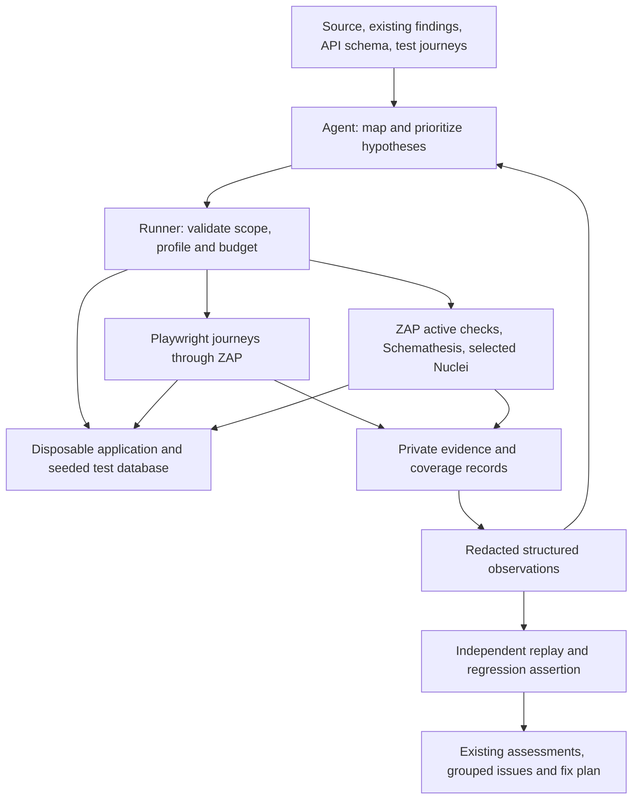

# Agent-powered DAST proposal

Research date: 2026-10-22. Status: broader design proposal. A separate
[local-dast skill](../skills/local-dast/SKILL.md) now implements the first slice:
bounded request assertions, including login sessions and state-changing cases behind
`--allow-writes` (added 2026-11-12), and ZAP passive analysis of recorded traffic. Active scans,
browser journeys and additional engines described below remain proposed.
Upstream documentation and repository licenses were inspected. This research
inventory is not a comparative benchmark or redistribution clearance. License labels
below describe the named projects, not their complete dependency distributions.

## Recommendation

Add a standalone `local-dast` runtime workflow for owned,
trusted applications in disposable local environments. Start with ZAP and
Playwright; add Schemathesis for API testing and curated Nuclei templates next.
Use the existing agent to choose hypotheses, interpret evidence, and produce
regression tests. A deterministic runner controls execution and records results.

The useful differentiator is source-informed runtime verification: connect source
findings, reachable routes, identities, observed behavior, and a reproducible test.
Scanner orchestration alone does not establish authorization or business-logic
correctness. Application-specific expectations remain necessary.

## Fit with this collection

The inspected working tree was clean at `bfca739`. The current workflow already
provides SAST, SCA, secrets, context mapping, candidate investigation, agent hunting,
and a fix plan. Preserve those stages and their scanner safety, integrity,
redaction, and licensing boundaries.

- Expose `local-dast` separately from `local-security-review`, following the
  maintainer's subsequent request and updated [AGENTS.md](../AGENTS.md).
  Runtime, API, and authorization adapters belong inside the standalone skill.
- Invoke `$local-dast` for runtime work. Deep active profiles remain proposed.
  A normal static review must not silently start an application.
- Keep setup and runtime instructions inside the installed skill directory.
- Reuse `context.md`, assessments, issue grouping, and the existing fix-plan flow.
  Runtime-only findings need a versioned schema extension: the current renderer
  assumes file locations and path/line evidence. Do not invent source lines to fit
  that schema. Preserve compatibility with existing reports.
- Keep review and application of fixes separate. Confirmation tests can run in the
  disposable copy; moving them into the working tree belongs to the requested fix.

Relevant existing contracts: [security skill](../skills/local-security-review/SKILL.md),
[renderer](../skills/local-security-review/scripts/render_review.py), and
[license boundary](../skills/local-security-review/references/licensing.md).

## Tool selection

| Component | Upstream license | Proposed role and decision |
| --- | --- | --- |
| [ZAP](https://github.com/zaproxy/zaproxy) | Apache-2.0 | Primary HTTP proxy, passive rules and bounded active DAST. Start here. |
| [Playwright](https://github.com/microsoft/playwright) | Apache-2.0 | Authenticated journeys, separate browser contexts, application-specific assertions. Reuse existing project tests where possible. |
| [Schemathesis](https://github.com/schemathesis/schemathesis) | MIT | OpenAPI/GraphQL input and contract testing, stateful sequences. Add for API projects. |
| [Nuclei](https://github.com/projectdiscovery/nuclei) and [templates](https://github.com/projectdiscovery/nuclei-templates) | MIT / MIT | Selected known-vulnerability and configuration checks. Pin and review exact templates; never run the entire catalog by default. |
| [RESTler](https://github.com/microsoft/restler-fuzzer) | MIT | Alternative for deeper stateful REST API campaigns when Schemathesis leaves a demonstrated gap. |
| [mitmproxy](https://github.com/mitmproxy/mitmproxy) | MIT | Optional programmable traffic handling when ZAP cannot express a needed transformation. Avoid a second proxy initially. |
| [Katana](https://github.com/projectdiscovery/katana) | MIT | Extra crawling if ZAP plus application journeys demonstrably miss routes. |
| [ffuf](https://github.com/ffuf/ffuf) | MIT | Optional bounded content/parameter discovery against the isolated target. Source routes and schemas come first. |
| [Interactsh](https://github.com/projectdiscovery/interactsh) | MIT | Optional self-hosted callback evidence for blind findings. Disabled by default; no public callback service in the local profile. |
| [testssl.sh](https://github.com/testssl/testssl.sh) | GPL-2.0 | Optional deployment TLS checks; limited value when local TLS differs from deployment. Separate license review. |
| [SSLyze](https://github.com/nabla-c0d3/sslyze) | AGPL-3.0 | Another TLS option, not a default dependency under the current allowlist. |
| [Wapiti](https://github.com/wapiti-scanner/wapiti) | GPL-2.0 | Alternative web scanner to evaluate if ZAP misses a measurable class of findings. Avoid duplicating engines without evidence. |

ZAP's [Automation Framework](https://www.zaproxy.org/docs/automate/automation-framework/)
supports declarative plans, authentication, API imports, scan jobs, and reports.
Use it for repeatable runs and the API for bounded interactive follow-ups.
Its [MCP integration](https://www.zaproxy.org/docs/desktop/addons/mcp-integration/)
already exposes agent tools. A new general ZAP MCP server is unnecessary.

Use the CLI runner first. If MCP is useful across hosts, expose the same narrow
operations through a thin adapter. Keep ZAP's management interface private and
authenticated; do not expose unrestricted management tools directly to target
content or the agent's browser. MCP is a transport, not a scope boundary.

Playwright supports [separate authenticated contexts](https://playwright.dev/docs/auth).
Schemathesis supports [stateful operation chaining](https://schemathesis.readthedocs.io/en/stable/explanations/stateful/)
and [checks](https://schemathesis.readthedocs.io/en/stable/reference/checks/), including
security-oriented checks. Configure identities and expected object access for the
application; schema validity alone cannot establish its complete access policy.

## Execution architecture

One Python CLI with a few engine-specific functions and JSON files is sufficient
initially. No service cluster, task queue, vector database, or new agent framework
is necessary. Run engines sequentially first so total request budgets and
application state are easier to reason about.

The runner owns a run record: source snapshot identifier, target origin, resolved
network destinations, allowed operations, test identity references, tool versions,
template hashes, limits, and evidence location. Configuration may contain secret
references but never real credentials. An allowlisted origin is an exact
scheme/host/port tuple, not a string prefix or a blanket private-network permission.

The runner exposes bounded operations: prepare, observe, scan, replay, summarize,
and stop. The agent proposes operations and receives structured results; it cannot
relax the run's scope through page content or scanner output. In an agent host with
arbitrary shell access, this wrapper alone is not a security boundary: OS/container
isolation and host tool permissions must enforce the same restrictions.

## The agent loop

1. Map routes, authentication, authorization, data ownership, and external effects
   from source, existing review context, schemas, and application tests.
2. Start a disposable snapshot with generated test data and test identities:
   anonymous, owner A, peer B, separate tenant, and privileged role where relevant.
3. Verify each identity against an explicit identity endpoint or assertion before,
   during, and after its tests. Lost authentication becomes a coverage gap.
4. Exercise known journeys through ZAP and record discovered operation/role pairs.
   Import API descriptions with their target URLs overridden to the local scope;
   block remote references and embedded servers outside that scope.
5. Run selected checks. Prioritize a changed sensitive route, a reachable SAST
   candidate, or an untested role boundary over repeating broad discovery.
6. Form a concrete hypothesis, choose the smallest bounded follow-up, compare
   expected and observed behavior, and update the assessment. Stop when the budget
   expires, authentication fails, the target becomes unhealthy, or further actions
   add no useful evidence.
7. Reproduce important findings from reset fixtures with a deterministic assertion.
   A scanner alert or an HTTP 200 alone does not confirm the claimed impact.

For example: create a synthetic document owned by A; verify A can read it; verify
whether B can read its private fields; assert the documented access policy.
Then connect a failure to the relevant authorization code and preserve a regression
test. Apply the same approach to tenant separation, role changes, workflow state,
and server-side enforcement of fields the UI does not expose.

## Profiles and isolation

| Proposed profile | Behavior |
| --- | --- |
| Observe | Known journeys and passive analysis of their traffic. No vulnerability mutation. Journeys can still change application state. |
| Verify | Selected active rules and bounded role/object comparisons in disposable data. |
| Deep | Stateful fuzzing and additional reviewed templates; optional local callback receiver and longer budgets. |

Example initial limits, to calibrate rather than advertise as performance results:
15 minutes, 2,000 requests, 2 requests/second across workers, 10 hypotheses, and a
fixed model-token budget for Verify. Count browser traffic and retries as well as
scanner requests. Record stopped and skipped operations explicitly.

Enforce isolation outside the model:

- Use a dedicated container/VM network for the application, database, browser, and
  scanners. Block unintended internet, LAN, host-service, and metadata access.
  Enforce policy on redirects, DNS changes, WebSockets and browser subresources;
  scanners must not bypass it through direct sockets or an alternative proxy.
- Isolate the application too: a local app may otherwise send email, call payment
  services, or follow a server-side URL. Use local substitutes for these services.
- Setup can fetch reviewed dependencies separately. Execution uses pinned tools,
  image digests, add-ons and templates without automatic updates or downloads.
- Keep the Docker socket, host home directory and production credentials out of
  scanner and target containers. Use an ephemeral browser profile and test-only CA
  trust; never change the user's global certificate store for the scan.
- Keep model-provider connectivity in the trusted controller, outside the target
  network. Send only selected redacted observations under the workplace's approved
  provider policy. Local scanning does not imply local model inference.
- Treat application pages, source comments, schemas, tool output and reports as
  untrusted data. They cannot change scope, select credentials, or authorize tools.
- Restrict Nuclei to reviewed, hashed template IDs and approved protocols. Require
  signature verification, disable public OAST and automatic updates, and omit code,
  file, headless and self-contained execution in the initial profile. A
  [valid signature](https://docs.projectdiscovery.io/templates/reference/template-signing)
  establishes provenance/integrity, not suitability or non-destructiveness.

ZAP's [baseline scan](https://www.zaproxy.org/docs/docker/baseline-scan/) includes
spidering; passive analysis must not be described as zero-request or zero-effect.
External staging would require its own explicit target authorization and policy;
it is outside the initial local-only implementation.

## Evidence, coverage, and cost

Store raw artifacts in private temporary directories outside the repository with
restricted permissions and a documented retention policy. Browser state, HAR,
screenshots, traces, HTML, URLs and response bodies can contain credentials or
private data; redacting Authorization headers alone is insufficient.

Normalize candidates with engine/rule identity, method, route template, parameter,
role, fixture identity, expected/observed result, replay reference, and optional
source location. Add immutable artifact references and digests to the report schema.
Redact before sending evidence to the model or rendering shareable reports.

Reuse `confirmed`, `likely`, `needs-review`, `unreviewed`, and `false-positive`.
Group static and dynamic observations only when the evidence supports the same root
cause. Keep uncorrelated findings separate. Export JSON/Markdown first; SARIF can
follow for source-mapped findings without fabricated locations.

Report discovered operations, exercised operations, verified role/operation pairs,
scan rules actually run, auth failures, blocked requests, missing schemas, and
unfinished jobs. Any coverage percentage must name its denominator; routes known
from source are not necessarily the complete deployed attack surface.

Use deterministic tools for bulk traffic, normalize/deduplicate before model calls,
and ask the model to investigate bounded batches. Replay a captured case without
asking the model to rediscover it. Measure elapsed time, requests, model tokens,
provider cost where available, reproducibility, and false positives on known cases.
Open-source engines do not remove model or compute costs.

## Existing agentic systems

| Project | Observed license | How to use the research |
| --- | --- | --- |
| [Strix](https://github.com/usestrix/strix) | Apache-2.0 | First candidate for a separate local bake-off. It already offers an agentic workflow using Docker and an LLM. Evaluate its complete sandbox, dependencies, data handling and control surface before integrating. |
| [PentestGPT](https://github.com/GreyDGL/PentestGPT) | MIT | Compare autonomous task progression and persistence. Its broader pentest scope is not a direct substitute for this collection's review contract. |
| [Shannon](https://github.com/KeygraphHQ/shannon) | AGPL-3.0 | Relevant source-aware web/API testing reference and possible separately evaluated option. Outside the default license allowlist. |

These projects' capability statements are upstream claims, not results reproduced
here. Compare them on the same isolated fixtures, identities, request/time limits,
and evidence criteria. Prefer reuse if it meets those requirements with less code;
do not introduce a second autonomous framework merely to duplicate the host agent.

## Delivery order and acceptance criteria

1. **One complete runtime slice:** isolated sample app, ZAP plus one authenticated
   Playwright journey, redacted report, and an assertion proving an injected test
   defect. Verify the fixed variant no longer triggers it.
2. **Authorization verification:** multiple identities and tenants, identity checks,
   deterministic replays, source correlation, and the compatible report extension.
3. **API and template coverage:** Schemathesis and a small reviewed Nuclei pack.
   Measure additional confirmed findings and overhead before adding more engines.
4. **Portability:** package self-contained references/scripts, pin exact versions,
   document sources/notices, and add the same runner to disposable CI environments.
   Add MCP only if it reduces host integration work.

Before releasing an active profile, exercise: out-of-scope redirects, DNS changes,
direct egress attempts, target-initiated callbacks, expired sessions, prompt
injection in responses, tampered templates, secret-bearing artifacts, request-budget
exhaustion and cancellation. A blocked job must not become a clean scan. Regression
fixtures should include both intentionally vulnerable and fixed variants.

Run the [README verification commands](../README.md#verification) after package
implementation, plus the new runtime integration checks. Unit tests alone cannot
establish real scanner coverage or isolation.

For open-source distribution, preserve the existing [source notices](../SOURCES.md).
That file records security and bug-review source with no upstream repository
license found. Resolve those permissions or independently replace the affected
source before describing the entire collection as freely redistributable. New
runtime modules can be original code with an explicit license. Do not copy scanner
binaries, downloaded templates, databases, credentials, or run reports into Git.
